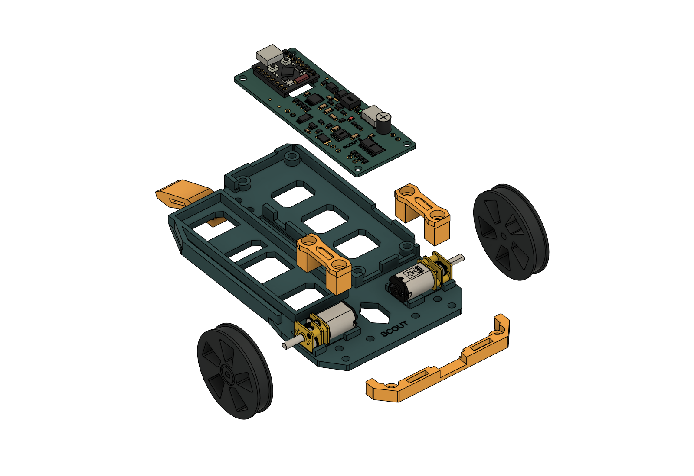

# C3 Scout Robot

A small rover built around an ESP32-C3 SuperMini, two N20 gearmotors, one 18650 cell and a printed chassis. Build it, drive it from a browser, and add animated OLED faces or a matching storage case.

**Start with the [Scout builder guide](https://mechatronicsaint.com/c3-scout/index.html).**

[The Build](https://mechatronicsaint.com/c3-scout/build.html) · [The Board](https://mechatronicsaint.com/c3-scout/board.html) · [The Code](https://mechatronicsaint.com/c3-scout/code.html) · [The Accessories](https://mechatronicsaint.com/c3-scout/accessories.html)



## Current release

The four-part builder guide was published **21 October 2026**. The [complete robot wiring diagram](https://mechatronicsaint.com/c3-scout/build.html#complete-wiring) was added **25 October 2026**, with an [editable SVG](docs/builder-guide/assets/wiring/scout-complete-wiring.svg).

| Area | Current edition |
| --- | --- |
| Mechanics and printed robot parts | Rev B, all M3 hardware |
| Electronics and factory files | Carrier C v10 / Silk 03 |
| Browser control firmware | 19 October 2026 · SCOUT 2 / protocol 2 |
| Optional Android app | 1.2.0 |
| ScoutFaces Arduino library | 1.0.0 · ten animated expressions |
| Storage cases | Bumper, OLED and ESP32-CAM · all v8 |

## Browse or download

GitHub displays HTML files as source. Use the live guide above for illustrated instructions, or clone/download this repository and run the following from its root:

```sh
python -m http.server 8000
```

Open [the local guide](http://localhost:8000/index.html). Keep the full folder layout together so images, downloads and technical references work offline.

- [Current firmware and software ZIP](06-Scout-Control/Scout-Control-Web-2026-10-19.zip) — firmware images, editable source, tests, technical guide and optional Android APK.
- [Complete technical control guide](https://mechatronicsaint.com/c3-scout/06-Scout-Control/CONTROL-GUIDE.html) — wiring, setup, protocol, calibration and recorded checks.
- [ScoutFaces 1.0.0 ZIP](06-Scout-Control/ScoutFaces-1.0.0.zip) — install in Arduino with **Sketch → Include Library → Add .ZIP Library**.
- [ScoutFaces source](libraries/ScoutFaces/) and complete [AutoCycle](libraries/ScoutFaces/examples/AutoCycle/AutoCycle.ino) / [SelectExpression](libraries/ScoutFaces/examples/SelectExpression/SelectExpression.ino) examples.

Each case package includes editable Fusion and STEP models, STL parts, Bambu P1S PLA projects, previews and print notes. Use the matching latch for the chosen variant.

| v8 case | Complete download | Native Fusion | STL and 3MF files |
| --- | --- | --- | --- |
| Bumper | [ZIP](08-Storage-Cases/Bumper/Scout-Bumper-Case-v8-Thin-Walls.zip) | [F3D](08-Storage-Cases/Bumper/Scout-Bumper-Case-v8.f3d) | [Files and print guide](08-Storage-Cases/Bumper/) |
| OLED | [ZIP](08-Storage-Cases/OLED/Scout-OLED-Case-v8-Thin-Walls.zip) | [F3D](08-Storage-Cases/OLED/Scout-OLED-Case-v8.f3d) | [Files and print guide](08-Storage-Cases/OLED/) |
| ESP32-CAM | [ZIP](08-Storage-Cases/ESP32-CAM/Scout-ESP32-CAM-Case-v8-Thin-Walls.zip) | [F3D](08-Storage-Cases/ESP32-CAM/Scout-ESP32-CAM-Case-v8.f3d) | [Files and print guide](08-Storage-Cases/ESP32-CAM/) |

## Load the firmware and drive

1. **Open RUN before connecting ESP USB.** Keep RUN open while programming or charging.
2. Install Arduino ESP32 core 3.x. Select **ESP32C3 Dev Module** and enable **USB CDC On Boot**.
3. Install **WebSockets 2.7.2**, Adafruit SSD1306/GFX and their dependencies, plus ScoutFaces. Follow [The Code](https://mechatronicsaint.com/c3-scout/code.html) for the matching build and upload instructions. The production sketch is [firmware/ScoutDrive](firmware/ScoutDrive/).
4. After uploading, unplug ESP USB, lift the wheels for the direction check, then close RUN.
5. Join Scout's Wi-Fi, open **http://192.168.4.1/** and press **Connect**. Start with the default 35% drive limit. Release the joystick to send zero; press **Stop** to end control. Reload the browser after updating firmware.

Motor directions are saved on the ESP. This Scout was tested with both reverse switches ON; a fresh or erased board defaults both OFF. Check directions with the wheels lifted and save the appropriate settings.

Browser control sends commands every 100 ms and has a 1000 ms ESP command cutoff. After command loss, motors may continue for up to one second. The optional Android app retains its 400 ms cutoff. Opening RUN cuts motor power independently of software.

## Editable software and documentation

Use the top-level folders for ongoing development:

| Source | Contents |
| --- | --- |
| [firmware/](firmware/) | Production ESP32-C3 sketch, embedded browser controller, OLED sketches and host tests |
| [libraries/ScoutFaces/](libraries/ScoutFaces/) | Reusable animated-face library and both examples |
| [android/](android/) | Optional native Android app and controller tests |
| [scripts/](scripts/) | Build, upload, packaging and verification helpers |
| [docs/](docs/) | Control notes and editable builder-guide content under `builder-guide/` |

[06-Scout-Control/source/](06-Scout-Control/source/) is the frozen source copy for the published 19 October software release. Its files accompany the downloadable guide and package. The top-level source folders are the canonical editable copies; release copies should be refreshed together when publishing another release.

Build helpers accept local tool paths where supported. See the guide and script parameters for the required Arduino, Java, Android and host-test tools. Building firmware does not upload it.

## Hardware files

| Folder | Contents |
| --- | --- |
| [01-Electronics-CarrierC](01-Electronics-CarrierC/) | Current schematic, board, library, PDFs, sourcing workbook and electrical checks; historical reviews are marked |
| [02-Mechanical-RevB](02-Mechanical-RevB/) | Full rover, chassis and populated mechanical board in Fusion and STEP formats |
| [03-Print-STL](03-Print-STL/) | Robot print parts, print notes and M3 fastener list |
| [04-Component-References](04-Component-References/) | Manufacturer datasheets, reference geometry and source notes |
| [05-Factory-CarrierC-v10](05-Factory-CarrierC-v10/) | Matching Gerbers, BOM, placement files and factory upload guide |
| [07-Bumper-Options](07-Bumper-Options/) | Optional OLED and ESP32-CAM bumper prototypes |
| [08-Storage-Cases](08-Storage-Cases/) | All three v8 case releases |

## Prototype status and provenance

Carrier C's electrical component placement has not been synchronized into the populated Rev B mechanical model. Check actual module, connector and fastener clearances before fabrication. Full v8 case fit and the optional bumper mounts still require physical verification. The ESP32-CAM mount includes no camera firmware or Scout camera power/control integration.

The factory guide records the checked Carrier C v10 release; use its matching files together. Electrical protection, motor stall current, supply startup and temperature still require prototype qualification. The circuit has no charge-and-run load sharing.

[PROJECT-MANIFEST.json](PROJECT-MANIFEST.json) records the published project files, hashes and revision status; [CURRENT-RELEASE.json](CURRENT-RELEASE.json) summarizes the editions. Manufacturer PDFs and reference models retain their original ownership. The Pololu model is a generic N20-family reference rather than verified geometry for the purchased Coliao motors; see [reference notes](04-Component-References/REFERENCE-NOTES.txt). No project-wide license has been selected.
