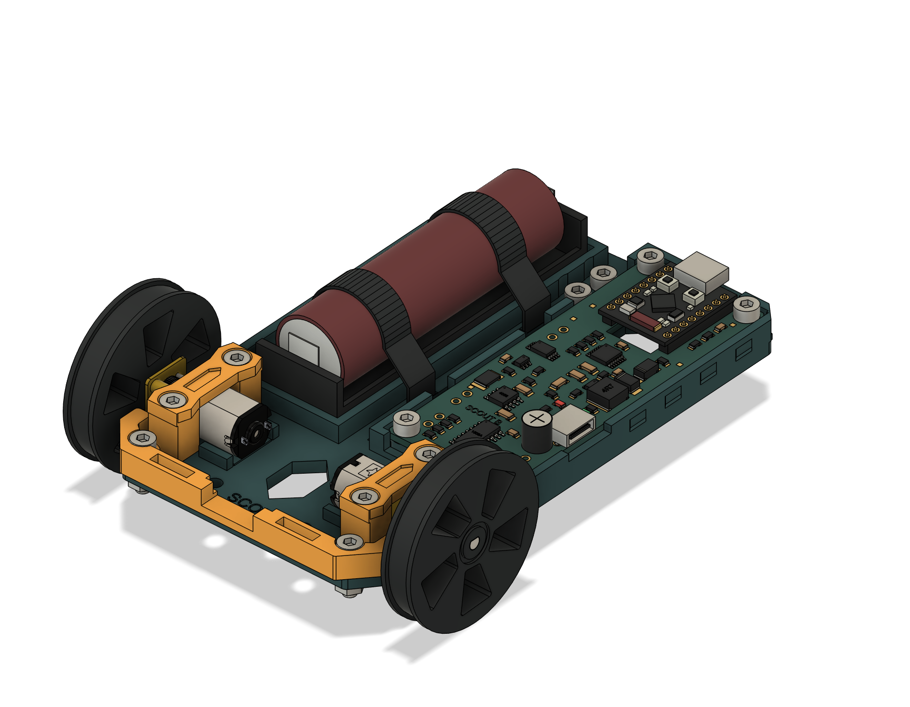

# C3 Scout Robot

A small rover built around an ESP32-C3 SuperMini, two N20 gearmotors, one 18650 cell, and a 3D-printed chassis with printable wheels, a tail skid, and M3 cap-head hardware.

[Explore the project](https://mechatronicsaint.com/c3-scout/index.html) · [Electrical design review](https://mechatronicsaint.com/c3-scout/01-Electronics-CarrierC/Carrier-Review.html) · [Download the project snapshot](https://mechatronicsaint.com/downloads/c3-scout/C3-Scout-Robot-Project.zip)

## Current revisions

This repository starts with the project snapshot collected on **4 October 2026**.

| Area | Latest included version | Status |
| --- | --- | --- |
| Electrical design | Carrier C | Fusion schematic, routed board, library, design rules, PDFs, BOM, and check reports |
| Physical assembly | Rev B | Complete rover and standalone populated board and chassis in Fusion and STEP formats |
| Printed parts | Rev B, all M3 | Chassis, motor clamps, bumper, tail skid, wheels, and optional shaft-fit coupon |
| Firmware | Not implemented for Carrier C | GPIO and startup guidance are in the electrical review |

**Carrier C's component placement has not yet been synchronized into the Rev B 3D board and chassis assembly.** This is a prototype design snapshot, not a manufacturing release. Manufacturing Gerbers and pick-and-place files are not included.

## Find the files

| Folder | Contents |
| --- | --- |
| [01-Electronics-CarrierC](01-Electronics-CarrierC/) | Matching `.sch` and `.brd`, component `.lbr`, JLCPCB-based `.dru`, schematic and layout PDFs, sourcing BOM, interactive review, and verification reports |
| [02-Mechanical-RevB](02-Mechanical-RevB/) | Full rover, standalone chassis, and populated board as `.f3d` and `.step`; previews and mechanical checks |
| [03-Print-STL](03-Print-STL/) | Printable parts, [print notes](03-Print-STL/PRINT-NOTES.txt), and [M3 fastener list](03-Print-STL/Fasteners-M3.csv) |
| [04-Component-References](04-Component-References/) | Manufacturer datasheets, motor reference geometry, and [source notes](04-Component-References/REFERENCE-NOTES.txt) |

## Open the project

1. Clone this repository or use GitHub's **Code → Download ZIP**.
2. Open `START-HERE.html` locally for the file index, or use the hosted project link above.
3. Open the `.f3d` files in Fusion for the mechanical design. The full rover preserves the original feature history; the standalone populated board is a direct-design snapshot.
4. Open the matching `C3-Carrier-RevC.sch` and `C3-Carrier-RevC.brd` together in Fusion Electronics. Keep the supplied library and design-rule file with them.
5. Read the print notes and revision status before making parts.

The carrier integrates the TC1508A motor driver, TP4056 charger, DW01A/FS8205A cell protection, MT3608 boost supply, and TXU0104 level translator. The SuperMini is soldered on as a module.

## Checks and remaining work

The included native Fusion reports record **0 board DRC errors, 0 unrouted connections, and 13 reviewed ERC supply-name warnings**. Standalone mechanical exports were reopened and their geometry checked in Fusion. These reports describe this snapshot; rerun the checks after editing.

Before fabrication, synchronize Carrier C into the physical assembly, check actual module and connector fit, confirm assembly stock and rotations, and bench-test motor stall current, supply startup, ripple, and temperature. Keep RUN off while charging or programming; this circuit has no charge-and-run load sharing. See [project notes](README.txt) and the electrical review for details.

## Provenance

The 64 original project files are retained byte for byte. [PROJECT-MANIFEST.json](PROJECT-MANIFEST.json) records their source paths, hashes, and verification results; it describes the collected snapshot rather than future repository revisions. Repository-only documentation and Git configuration are additions to that snapshot.

Manufacturer PDFs and reference models retain their original ownership. The Pololu motor is a generic N20-family reference, not verified geometry or electrical ratings for the purchased Coliao motors. Source details are in the reference folder. No project-wide license has been selected.
